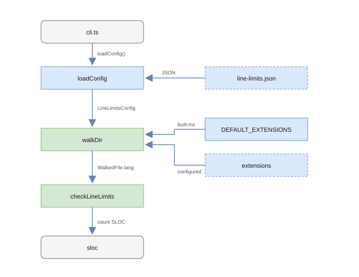

# Architecture

Four modules around the `sloc` line counter.

## Overview

The CLI loads `line-limits.json` into a `LineLimitsConfig`, walks each configured directory, and passes every file to `sloc` with the language resolved from its extension. `DEFAULT_EXTENSIONS` holds the built-in TypeScript and JavaScript mappings. `resolveExtensions` merges them with the mappings in `extensions`.

## Modules

- [`config.ts`](https://github.com/johanneslatzel/check-line-limits/blob/main/src/config.ts): defines `LineLimitsConfig`, `DEFAULT_EXTENSIONS`, and `DEFAULTS`; loads the JSON config with `readFileSync` and merges partial configs over the defaults; `resolveExtensions` merges the configured extension mappings over the built-in ones.
- [`walker.ts`](https://github.com/johanneslatzel/check-line-limits/blob/main/src/walker.ts): walks each scan directory recursively with `readdirSync`; prunes directories named in `skipDirs`; keeps only files whose extension resolves through `DEFAULT_EXTENSIONS` and the configured `extensions`, records the resolved `sloc` language, and drops files matched by an exclude pattern.
- [`check-line-limits.ts`](https://github.com/johanneslatzel/check-line-limits/blob/main/src/check-line-limits.ts): reads each walked file and counts SLOC through the CJS `sloc` package (default import, typed by `@types/sloc`) using the language resolved by the walker; classifies each file as `ok`, `warn`, or `error`.
- [`cli.ts`](https://github.com/johanneslatzel/check-line-limits/blob/main/src/cli.ts): parses `--config`, `--warn`, `--error`, and `--json`; writes warnings and errors to stderr, success messages to stdout; exits `1` when any file reaches the error threshold.

[`index.ts`](https://github.com/johanneslatzel/check-line-limits/blob/main/src/index.ts) re-exports the public API: `checkLineLimits`, `loadConfig`, and the three result and config types. The CLI is a separate entry point.

## Design Decisions

- One runtime dependency (`sloc`); walking, exclusion matching, and IO use `node:fs` and `node:path` only.
- Extension support is data, not code: projects add mappings in `line-limits.json` instead of editing the package.
- Filesystem operations are synchronous.
- Unreadable files and nonexistent scan directories are skipped silently.
- Exclusion patterns match suffixes (`**/*.d.ts`), directory prefixes (`dist/**`), and infixes (`**/*.generated.*`); see [`isExcluded`](https://github.com/johanneslatzel/check-line-limits/blob/main/src/walker.ts).
